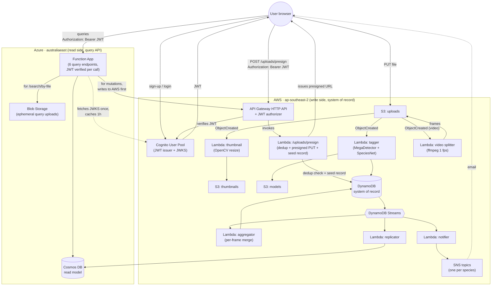

# Architecture diagram

**Owner:** P1 (Adam).
**For:** Team report (assignment §6.2 requires official cloud-provider icons).
**Status:** Draft (mermaid). Final version needs to be redrawn in draw.io / Lucidchart / Excalidraw using the official AWS + Azure icon sets — see [Final-version checklist](#final-version-checklist) below.

## TL;DR shape

CQRS split across two clouds. Cognito spans both — same JWT verified on both sides, no second auth store.

- **AWS = write side.** Ingestion, ML, system of record.
- **Azure = read side.** Query API serving a replicated read model.
- **One JWT works on both clouds.** Cognito issues it; Azure verifies it against Cognito's JWKS endpoint.

## Mermaid draft

If you paste this into [mermaid.live](https://mermaid.live) you'll get a rendered preview. The team report needs a proper PNG/SVG with official icons — see below.

## Reading the diagram

- **Authentication** is unified through Cognito. The browser holds one JWT.
- **Writes** go to AWS: presigned-URL upload to S3, Lambdas process, DynamoDB stores.
- **Reads** go to Azure: Function App queries Cosmos, which is fed by DynamoDB Streams via the Replicator Lambda.
- **Notifications** are one SNS topic per species. Users subscribe by email through the UI.
- **The only cross-cloud call** is `/search/by-file` (user uploads a query image to Azure → Azure ships it to AWS Tagger for inference → returns matching files from Cosmos → deletes the blob).

## Final-version checklist

The brief requires "official architecture icons for all involved cloud providers." The mermaid above is a logical sketch — for submission, redraw it in a proper tool.

### Recommended tool

**draw.io** (now diagrams.net) — free, has AWS and Azure icon sets built in. Or **Lucidchart** if you have a student licence. Excalidraw with the AWS icon library works too but looks less formal.

### Icons to use

**AWS** (Architecture Icons 2024+ set):

| Resource | Icon name |
|---|---|
| Cognito User Pool | "Amazon Cognito" |
| API Gateway HTTP API | "Amazon API Gateway" |
| Lambda (each one) | "AWS Lambda" |
| S3 buckets | "Amazon Simple Storage Service" |
| DynamoDB | "Amazon DynamoDB" |
| DynamoDB Streams | "Amazon DynamoDB" (with the "Streams" sub-label) |
| SNS | "Amazon Simple Notification Service" |
| CloudFormation (optional) | "AWS CloudFormation" |
| IAM (optional) | "AWS Identity and Access Management" |

**Azure** (current icon set):

| Resource | Icon name |
|---|---|
| Function App | "Function Apps" |
| Cosmos DB | "Azure Cosmos DB" |
| Blob Storage | "Storage Accounts" or specifically "Blob" |
| Application Insights (if added) | "Application Insights" |

### Layout suggestions

- Left → right flow.
- AWS in a big group on the left, Azure in a big group on the right, Cognito straddling the top.
- Solid arrows = synchronous calls. Dashed arrows = async / streams.
- Label every arrow with the protocol or trigger ("HTTPS + JWT", "S3 ObjectCreated", "DDB Stream", etc.).
- Put the user in the top-left, outside the cloud boxes.

### Things to make sure show up

- Cognito as the single auth provider (a callout arrow from Azure to Cognito's JWKS makes the cross-cloud trust visible).
- The CQRS split labelled explicitly (a vertical divider with "write side" / "read side" labels).
- The presigned-URL upload (browser PUTs to S3 directly, not through API Gateway).
- The dedup check (the `/uploads/presign` Lambda reads DynamoDB, then seeds the metadata record).
- The aggregator's role for videos (it sits on the streams, not on S3 events).

### Don't show

- Resources we deliberately left out: Identity Pool, ElastiCache, secondary regions, custom KMS keys. The diagram should be the system that exists, not the one a marker might expect.
- Implementation details: VPC, subnets, security groups (not applicable to our serverless setup).
- Internal AWS plumbing: IAM roles, CloudWatch — these clutter the diagram without adding meaning at the architecture level.

## Updating this draft

When the system changes, update the mermaid here first (it's source-controlled and reviewable in a PR). Re-export the official-icon version from the same shape. If the mermaid and the official version diverge, the mermaid is the truth.
