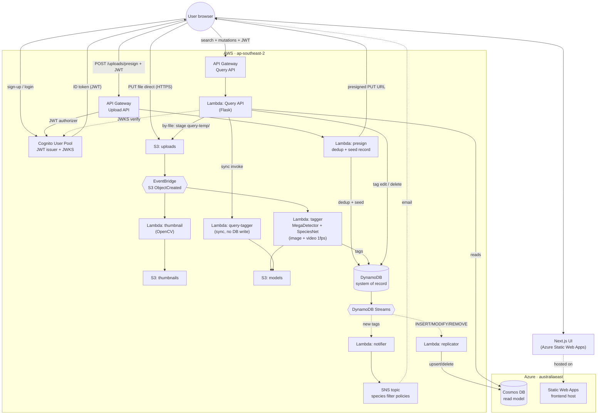

# Architecture diagram

**Owner:** P1 (Adam).
**For:** Team report (assignment §6.2 requires official cloud-provider icons).
**Status:** Draft (mermaid, updated 2026-06). Final version needs to be redrawn in draw.io / Lucidchart using the official AWS + Azure icon sets — see [Final-version checklist](#final-version-checklist) below.

## TL;DR shape

CQRS split across two clouds. Cognito spans the system — same JWT on both API Gateways, no second auth store.

- **AWS (`ap-southeast-2`) = write side + query compute.** Ingestion, ML, DynamoDB (system of record), both API Gateways, all Lambdas.
- **Azure (`australiaeast`) = read data + frontend hosting.** Cosmos DB (replicated read model), Static Web Apps (production UI).
- **Query API runs on AWS Lambda (Flask), not Azure Functions.** It reads Cosmos on Azure; mutations write DynamoDB on AWS first.
- **One JWT works everywhere.** Cognito issues it; both API Gateways and the Flask middleware verify it against Cognito JWKS.

## Mermaid draft

Paste into [mermaid.live](https://mermaid.live) for a quick preview. Redraw with official icons for submission.

## Reading the diagram

### Authentication

The browser authenticates via Cognito SRP and stores an **ID token**. Every API call sends `Authorization: Bearer <token>`. Both API Gateways use a Cognito JWT authorizer; the Query API Flask app also verifies RS256 + JWKS in `lambdas/api_handlers/auth.py`.

### Upload (write path)

1. Client hashes file (SHA-256) and calls `POST /uploads/presign`.
2. Presign Lambda checks DynamoDB for duplicates, seeds a metadata record if new, returns a presigned S3 PUT URL.
3. Browser uploads **directly to S3** (not through API Gateway).
4. S3 emits ObjectCreated events to **EventBridge**.
5. **Thumbnail Lambda** (images) and **Tagger Lambda** (images + videos) run in parallel.
6. Tagger lazy-loads models from S3, runs MegaDetector → SpeciesNet, writes species counts to DynamoDB.
7. Video processing is **inside the Tagger container** (ffmpeg 1 fps, aggregate frame tags) — no separate splitter or aggregator Lambdas.

### Replication and notifications (async)

DynamoDB Streams fan out to:

- **Replicator** → upsert/delete documents in **Azure Cosmos DB** (cross-cloud dashed arrow).
- **Notifier** → publish to **one SNS topic** with a `species` message attribute; subscription filter policies route emails per watched species.

### Query (read path)

The **Query API** (Flask on AWS Lambda) serves all search and mutation endpoints:

| Reads (Cosmos)                       | Writes (DynamoDB first) |
| ------------------------------------ | ----------------------- |
| `/search/tags`, `/search/species`    | `/tags/modify`          |
| `/search/by-thumbnail`               | `/files/delete`         |
| `/search/by-file`                    |                         |
| `/files/list`, `/files/status/<sha>` |                         |
| `GET/POST /tags/subscribe` (SNS)     |                         |

Mutations write DynamoDB; the replicator updates Cosmos within ~1–2 seconds (eventual consistency).

### Search-by-file (special path)

1. Query API receives multipart image upload.
2. Stages file under `query-temp/` in the **uploads S3 bucket** (not Azure Blob).
3. **Sync-invokes query-tagger** Lambda (same container image, tag-only handler, no persistence).
4. Searches Cosmos by returned species tags.
5. Deletes the temp S3 object. Tagger and thumbnail Lambdas skip `query-temp/` keys.

### Frontend hosting

Production UI is a **Next.js static export** deployed to **Azure Static Web Apps** via GitHub Actions. API calls from the browser still target the **AWS API Gateway** URLs.

## Component list (for draw.io)

Use this as a box checklist when redrawing with official icons.

### User / client

| Label          | Notes                                         |
| -------------- | --------------------------------------------- |
| User (browser) | Outside cloud boundaries, top-left            |
| Next.js UI     | Static export; arrow to Azure SWA for hosting |

### AWS (`ap-southeast-2`)

| Label                      | Icon                                       |
| -------------------------- | ------------------------------------------ |
| Cognito User Pool          | Amazon Cognito                             |
| API Gateway — Upload API   | Amazon API Gateway                         |
| API Gateway — Query API    | Amazon API Gateway                         |
| Lambda: presign            | AWS Lambda                                 |
| Lambda: Query API (Flask)  | AWS Lambda                                 |
| Lambda: thumbnail          | AWS Lambda                                 |
| Lambda: tagger (container) | AWS Lambda                                 |
| Lambda: query-tagger       | AWS Lambda                                 |
| Lambda: replicator         | AWS Lambda                                 |
| Lambda: notifier           | AWS Lambda                                 |
| S3: uploads                | Amazon S3                                  |
| S3: thumbnails             | Amazon S3                                  |
| S3: models                 | Amazon S3                                  |
| EventBridge                | Amazon EventBridge (optional but accurate) |
| DynamoDB                   | Amazon DynamoDB                            |
| DynamoDB Streams           | Amazon DynamoDB (Streams sub-label)        |
| SNS topic                  | Amazon SNS                                 |

### Azure (`australiaeast`)

| Label           | Icon                  |
| --------------- | --------------------- |
| Cosmos DB       | Azure Cosmos DB       |
| Static Web Apps | Azure Static Web Apps |

## Arrow labels (for draw.io)

| From           | To             | Label                       | Style               |
| -------------- | -------------- | --------------------------- | ------------------- |
| User           | Cognito        | sign-up / login             | solid               |
| Cognito        | User           | ID token (JWT)              | solid               |
| User           | Upload API GW  | POST /uploads/presign + JWT | solid               |
| Upload API GW  | Presign λ      | invoke                      | solid               |
| Presign λ      | DynamoDB       | dedup check + seed record   | solid               |
| Presign λ      | User           | presigned PUT URL           | solid               |
| User           | S3 uploads     | PUT file direct             | solid               |
| S3 uploads     | EventBridge    | ObjectCreated               | dashed              |
| EventBridge    | Thumbnail λ    | image events                | dashed              |
| EventBridge    | Tagger λ       | image + video events        | dashed              |
| Thumbnail λ    | S3 thumbnails  | write `<sha>.jpg`           | solid               |
| Tagger λ       | S3 models      | read models                 | solid               |
| Tagger λ       | DynamoDB       | write tags                  | solid               |
| DynamoDB       | Streams        | change feed                 | dashed              |
| Streams        | Replicator λ   | INSERT/MODIFY/REMOVE        | dashed              |
| Streams        | Notifier λ     | new tag records             | dashed              |
| Replicator λ   | Cosmos DB      | upsert/delete               | solid (cross-cloud) |
| Notifier λ     | SNS            | publish per species         | solid               |
| SNS            | User           | email alert                 | dashed              |
| User           | Query API GW   | search + mutations + JWT    | solid               |
| Query API GW   | Query API λ    | invoke                      | solid               |
| Query API λ    | Cognito        | JWKS verify                 | dashed              |
| Query API λ    | Cosmos DB      | read queries                | solid (cross-cloud) |
| Query API λ    | DynamoDB       | mutations                   | solid               |
| Query API λ    | S3 uploads     | query-temp/ staging         | solid               |
| Query API λ    | Query-tagger λ | sync invoke                 | solid               |
| Query-tagger λ | S3 models      | read models                 | solid               |
| Next.js UI     | Azure SWA      | static assets hosted        | dashed              |

## Final-version checklist

The brief requires "official architecture icons for all involved cloud providers." The mermaid above is a logical sketch — for submission, redraw it in a proper tool.

### Recommended tool

**draw.io** (diagrams.net) — free, AWS and Azure icon sets built in. Or **Lucidchart** with a student licence.

### Icons to use

**AWS** (Architecture Icons 2024+ set):

| Resource             | Icon name                                       |
| -------------------- | ----------------------------------------------- |
| Cognito User Pool    | Amazon Cognito                                  |
| API Gateway HTTP API | Amazon API Gateway (draw twice: Upload + Query) |
| Lambda               | AWS Lambda (one icon per function)              |
| S3 buckets           | Amazon Simple Storage Service                   |
| EventBridge          | Amazon EventBridge                              |
| DynamoDB             | Amazon DynamoDB                                 |
| DynamoDB Streams     | Amazon DynamoDB (Streams sub-label)             |
| SNS                  | Amazon Simple Notification Service              |

**Azure**:

| Resource        | Icon name             |
| --------------- | --------------------- |
| Cosmos DB       | Azure Cosmos DB       |
| Static Web Apps | Azure Static Web Apps |

### Layout suggestions

- Left → right flow.
- Large **AWS** group on the left; **Azure** group on the right.
- Cognito at the top (spans both sides conceptually).
- Vertical divider label: **CQRS — AWS write | Azure read data**.
- Solid arrows = synchronous HTTPS / invoke. Dashed = async (streams, EventBridge, email).
- User in the top-left, outside cloud boxes.
- Label the presigned upload: browser PUTs to S3 **directly**, not through API Gateway.

### Things to make sure show up

- Cognito as the single auth provider (JWKS arrow from Query API λ to Cognito).
- **Two** API Gateways (Upload API vs Query API).
- CQRS split: DynamoDB = system of record; Cosmos = read model; mutations write DynamoDB first.
- Presigned-URL upload path (dedup at presign, direct S3 PUT).
- EventBridge decoupling (not direct S3 → Lambda on the diagram).
- Video tagging **inside** Tagger (no splitter/aggregator boxes).
- Search-by-file: S3 `query-temp/` + sync query-tagger invoke (not Azure Blob).
- Azure Static Web Apps for frontend hosting.
- Cross-cloud arrow: Replicator λ → Cosmos DB.

### Don't show

| Omit                                | Why                                     |
| ----------------------------------- | --------------------------------------- |
| Azure Function App                  | Query API is Flask on AWS Lambda        |
| Azure Blob Storage                  | Query files use S3 `query-temp/`        |
| video_splitter / aggregator Lambdas | Consolidated in Tagger container        |
| SNS "one topic per species"         | One topic; filter policies per species  |
| Cognito Identity Pool               | Not used in delivered upload flow       |
| VPC, subnets, security groups       | Serverless — not applicable             |
| IAM roles, CloudWatch               | Clutters diagram without adding meaning |

## Updating this draft

When the system changes, update the mermaid here first (source-controlled, reviewable in PR). Re-export the official-icon PNG/SVG from the same shape. If the mermaid and the submitted diagram diverge, **this file is the truth**.
